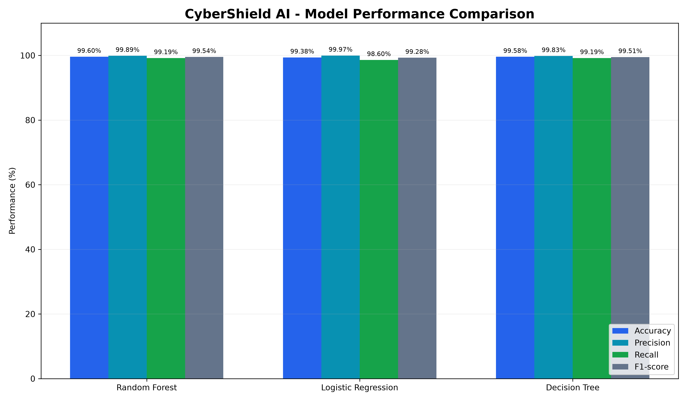
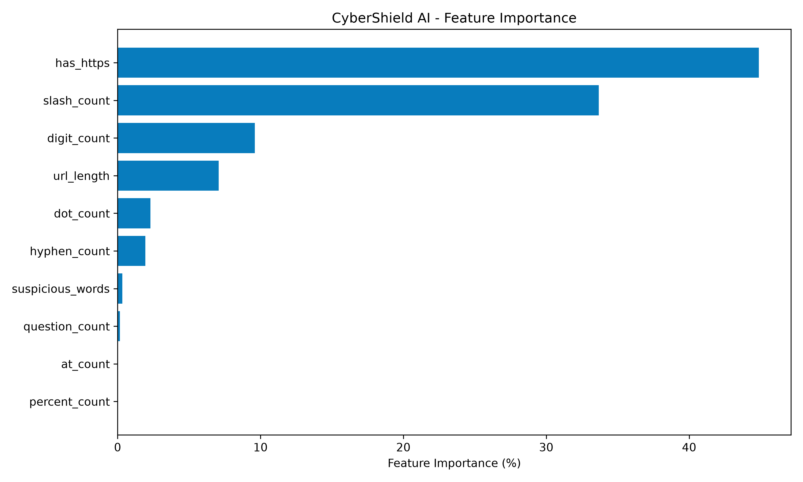
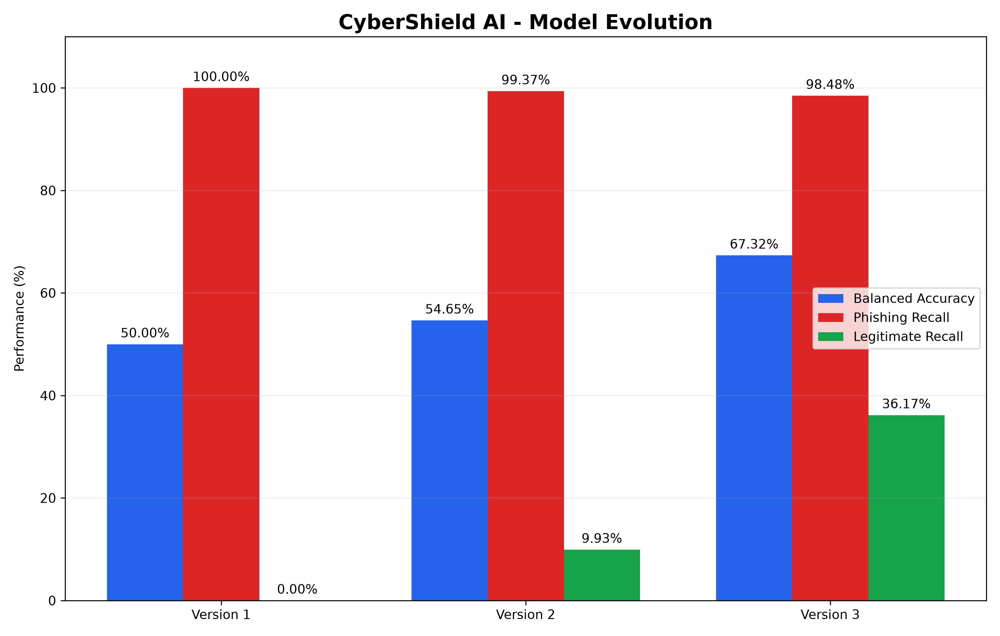

# CyberShield AI

## Investigating Dataset Bias and Machine Learning
## Generalization in Phishing URL Detection

### Overview

CyberShield AI is an independent cybersecurity research
project that investigates the effectiveness of machine
learning in detecting phishing URLs.

The project examines why machine learning models can
achieve high accuracy on one dataset but perform poorly
on unfamiliar data.

CyberShield also includes an interactive web application
that analyzes URL characteristics without visiting websites.

### Research Objectives

- Develop a machine learning-based phishing detector.
- Compare three classification algorithms.
- Investigate dataset bias and feature importance.
- Improve cross-dataset generalization.
- Evaluate performance on previously unseen domains.

### Technologies

- Python
- Scikit-learn
- NumPy
- Streamlit
- Matplotlib
- Joblib
- TLDExtract

### Datasets

Three publicly available research datasets were used:

| Dataset | Original records |
|---|---:|
| PhiUSIIL | 235,795 |
| URL-Phish V2 | 116,600 |
| LegitPhish V2 | 101,219 |

Dataset sources:

- https://archive.ics.uci.edu/dataset/967/phiusiil+phishing+url+dataset
- https://data.mendeley.com/datasets/65z9twcx3r/2
- https://data.mendeley.com/datasets/hx4m73v2sf/2

The datasets are not included in this repository.
Download them from their original sources.

### Algorithm Comparison

Three machine learning algorithms were evaluated
on the original held-out dataset.

| Algorithm | Accuracy | Precision | Recall | F1-score |
|---|---:|---:|---:|---:|
| Random Forest | 99.60% | 99.89% | 99.19% | 99.54% |
| Logistic Regression | 99.38% | 99.97% | 98.60% | 99.28% |
| Decision Tree | 99.58% | 99.83% | 99.19% | 99.51% |

### Dataset Bias Investigation

Although the initial Random Forest model achieved
99.60% accuracy, its accuracy decreased to 17.72%
on a separate dataset after hostname overlap filtering.

Feature importance analysis revealed that HTTPS
and slash count accounted for approximately 79%
of the model's impurity-based feature importance.

This suggested that the model may have learned
dataset-specific patterns rather than generalizable
phishing characteristics.

### Model Development

Version 1:
- Random Forest with 100 decision trees.
- Ten URL-based features.
- Trained using the PhiUSIIL dataset.

Version 2:
- Removed HTTPS and slash count.
- Eight URL-based features.
- External development-test accuracy improved
  from 17.72% to 73.14%.

Version 3:
- Combined two training datasets.
- Removed duplicate and conflicting URL records.
- Used domain-based training and validation separation.
- Evaluated on a third dataset.

### Final Evaluation

All three versions were evaluated using the same
filtered LegitPhish dataset containing 61,305 URLs.

| Metric | V1 | V2 | V3 |
| Accuracy | 99.77% | 99.16% | 98.33% |
| Balanced Accuracy | 50.00% | 54.65% | 67.32% |
| Phishing Recall | 100% | 99.37% | 98.48% |
| Legitimate Recall | 0% | 9.93% | 36.17% |

Version 3 achieved the highest balanced accuracy.

However, the final dataset was heavily imbalanced,
containing only 141 legitimate URLs after filtering.

These findings demonstrate why accuracy alone
is insufficient for evaluating cybersecurity models.

### Application

The web application includes:

- URL-based phishing classification.
- Machine learning prediction scores.
- Input validation and error handling.
- Custom Parrot OS-inspired geometric artwork.
- URL analysis without visiting target websites.

### Security Testing

- Automated input validation: 7 out of 7 tests passed.
- Bandit source code scan: No issues identified.
- pip-audit: No known vulnerabilities found at scan time.

These results do not guarantee complete security.

### Installation

Install the required Python dependencies:

    python -m pip install -r requirements.txt

Run the application locally:

    python -m streamlit run web_app.py --server.address localhost

The application requires the Version 3 trained model.

If the model is unavailable, download the first two
datasets, save them as dataset.csv and
external_dataset.csv, and run:

    python train_model_v3.py

Only load trusted Joblib model files.

### Reproducing the Experiments

Save the third dataset as final_dataset.csv.

Run the following scripts in order:

    python analyze_data.py
    python prepare_data.py
    python train_model.py
    python evaluate_model.py
    python compare_models.py
    python visualize_results.py
    python external_test.py
    python diagnose_model.py
    python feature_importance.py
    python train_model_v2.py
    python external_test_v2.py
    python train_model_v3.py
    python final_test.py
    python visualize_final.py

Do not open suspicious URLs from the datasets.

### Limitations

- The system analyzes URL text only.
- It does not inspect website content.
- Dataset bias affects model performance.
- The final evaluation dataset is heavily imbalanced.
- False positives and false negatives remain.
- Model scores are not calibrated risk probabilities.
- Further independent validation is required.

### Future Improvements

- Collect more diverse legitimate URL examples.
- Improve feature engineering.
- Investigate model calibration.
- Reduce false-positive rates.
- Conduct additional independent testing.

### Development Disclosure

This project was developed with AI-assisted learning,
programming, debugging, and documentation support.

### Disclaimer

CyberShield AI is an educational research prototype,
not a production security product. Its predictions
do not guarantee website safety.
